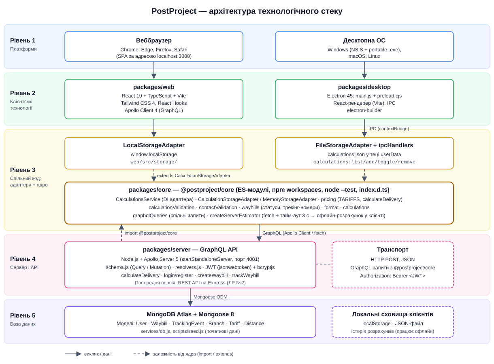

# PostProject - монорепозиторій

Кросплатформний застосунок поштової служби: калькулятор вартості доставки з історією розрахунків, електронні накладні, трекінг посилок та особистий кабінет. Один пакет бізнес-логіки `@postproject/core` працює у вебверсії, десктопній програмі та на сервері.



## Структура

```
PostProject-monorepo/
├── package.json        ← npm workspaces, спільні скрипти
├── images/             ← архітектурна схема (SVG і PNG)
└── packages/
    ├── core/           ← @postproject/core: тарифи, перевірки, накладні, CalculationsService
    ├── server/         ← GraphQL API (Apollo Server, MongoDB, JWT)
    ├── web/            ← вебклієнт (React, Vite, Tailwind CSS)
    └── desktop/        ← десктопний клієнт (Electron)
```

| Пакет | Призначення |
|---|---|
| [`packages/core`](packages/core) | Спільне ядро без залежностей від платформи |
| [`packages/server`](packages/server) | GraphQL API на ядрі: розрахунок, накладні, трекінг, авторизація |
| [`packages/web`](packages/web) | SPA для браузера, історія в `localStorage` |
| [`packages/desktop`](packages/desktop) | Windows, macOS, Linux, історія у файлі `calculations.json` |

## Запуск

```bash
npm install            # встановлює залежності всіх пакетів і посилання на @postproject/core
npm test               # тести всіх пакетів (56 тестів, fail 0)
npm run typecheck      # перевірка типів TypeScript у клієнтах
```

Сервер потребує файлу `packages/server/.env` (зразок - [`.env.example`](packages/server/.env.example)) із рядком `MONGO_URI`.

```bash
npm run seed           # початкові дані в MongoDB
npm run start:server   # GraphQL API на http://localhost:4001/
npm run start:web      # вебклієнт на http://localhost:3000/
npm run start:desktop  # збірка рендерера та запуск Electron
```

Без сервера калькулятор у всіх клієнтах працює офлайн: `createServerEstimator` чекає відповіді 3 секунди, після чого ядро рахує вартість на пристрої за тими самими тарифами.

## Технологічний стек і компетентності

### Стек технологій

| Рівень | Технології | ЛР | Де реалізовано |
|---|---|---|---|
| 1. Платформи | Веббраузер; Windows, macOS, Linux | №1, 4, 6 | [`web`](packages/web), [`desktop`](packages/desktop) |
| 2. Клієнтські технології | React 19, TypeScript, Vite, Tailwind CSS, Apollo Client; Electron + electron-builder | №1, 4, 6 | [`web/src`](packages/web/src), [`desktop/main.js`](packages/desktop/main.js), [`desktop/preload.cjs`](packages/desktop/preload.cjs) |
| 3. Спільний код | `@postproject/core` (ES-модулі, npm workspaces, `node --test`); адаптери `LocalStorageAdapter`, `FileStorageAdapter` | №7-8 | [`core`](packages/core), [`web/src/storage`](packages/web/src/storage), [`desktop/fileStorageAdapter.js`](packages/desktop/fileStorageAdapter.js) |
| 4. Сервер і API | Node.js, REST на Express (ЛР №2) → GraphQL на Apollo Server, JWT, bcryptjs | №2, 3 | [`server/schema.js`](packages/server/schema.js), [`server/resolvers.js`](packages/server/resolvers.js), [`server/auth.js`](packages/server/auth.js) |
| 5. База даних | MongoDB Atlas, Mongoose; локальні сховища клієнтів для історії | №2, 3 | [`server/models`](packages/server/models), [`server/services/db.js`](packages/server/services/db.js) |

### Сильні сторони проєкту

1. **Одне ядро на два середовища.** Тарифи, перевірка накладних, статуси й GraphQL-запити лежать у [`packages/core`](packages/core) та імпортуються і клієнтами, і сервером ([`server/resolvers.js`](packages/server/resolvers.js)).
2. **Спільне ядро + платформні адаптери.** `CalculationsService` отримує адаптер через конструктор; кожна платформа має лише свій клас із `load()` і `save()` ([`core/storageAdapter.js`](packages/core/storageAdapter.js), [`core/calculationsService.js`](packages/core/calculationsService.js)).
3. **Офлайн-режим.** [`core/deliveryEstimator.js`](packages/core/deliveryEstimator.js) звертається до `calculateDelivery` на сервері з тайм-аутом, а при недоступності сервера розрахунок виконується локально.
4. **Безпечний IPC в Electron.** `contextIsolation`, `preload.cjs` з чотирма каналами та перевірка типів даних з рендерера в [`desktop/ipcHandlers.js`](packages/desktop/ipcHandlers.js), яку покрито тестами без запуску вікна.

Найбільше розкрито роль **архітектора кросплатформного застосунку**: проєктування спільного ядра, адаптерів і контракту API, яким користуються всі клієнти.

### Що я знаю та вмію

- Порівнювати підходи до кросплатформної розробки (WebView, нативна компіляція, спільний UI) і обирати їх під задачу.
- Будувати REST API на Express та GraphQL API на Apollo Server: схема, резолвери, JWT-автентифікація, MongoDB через Mongoose.
- Розробляти SPA на React і TypeScript з Tailwind CSS та Apollo Client.
- Створювати десктопний застосунок на Electron: головний процес, preload, IPC, інсталятор через electron-builder.
- Організовувати монорепозиторій на npm workspaces, виділяти платформонезалежне ядро та покривати його тестами `node --test`.

### Історія проєкту

| Пункт | Зміст |
|---|---|
| **Назва проєкту** | PostProject - сервіс поштової доставки |
| **Проблема** | Клієнтам потрібно швидко дізнатися ціну й термін доставки, оформити накладну та відстежити посилку у браузері чи на робочому ПК, зокрема без стабільного інтернету. |
| **Моя роль і внесок** | Індивідуальний проєкт: проєктування архітектури, сервер і база даних, обидва клієнти, спільне ядро, тести та документація. |
| **Обраний стек** | **React + TypeScript** - одна мова й одна модель компонентів для вебу і десктопу (рендерер Electron). **Electron** - дозволив повторно використати вебінтерфейс і отримати доступ до файлової системи. **GraphQL** - клієнти запитують лише потрібні поля, а запити зберігаються в ядрі в одному місці. **MongoDB** - накладна з подіями трекінгу природно лягає в документ. **npm workspaces** - ядро доступне всім пакетам без публікації в npm. |
| **Найскладніший кросплатформний виклик** | Історія розрахунків зберігалася по-різному: синхронний `localStorage` у браузері та асинхронний запис у файл у головному процесі Electron, до якого рендерер не має доступу. Рішення - інтерфейс `CalculationStorageAdapter` з `load()`/`save()`, асинхронний `CalculationsService` у ядрі (працює і з синхронними, і з асинхронними адаптерами) та IPC-обробники в Electron, які викликають той самий сервіс у головному процесі. |
| **Здобуті знання та вміння** | Розуміння, як розділяти бізнес-логіку й платформу, проєктувати API для кількох клієнтів, забезпечувати офлайн-роботу та перевіряти спільний код тестами один раз для всіх платформ. |

## Посилання

- Репозиторій: [github.com/ValentinKxD/Cross-platform-labs](https://github.com/ValentinKxD/Cross-platform-labs)
- Монорепозиторій: [lab7-8/PostProject-monorepo](https://github.com/ValentinKxD/Cross-platform-labs/tree/main/lab7-8/PostProject-monorepo)
- Вебверсія ЛР №1: [valentinkxd.github.io/PostProject](https://valentinkxd.github.io/PostProject/)
